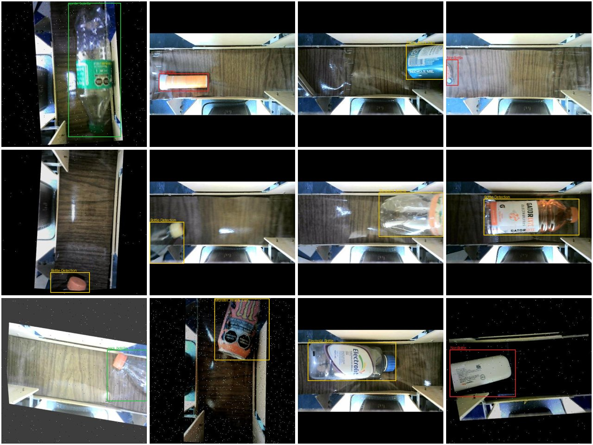
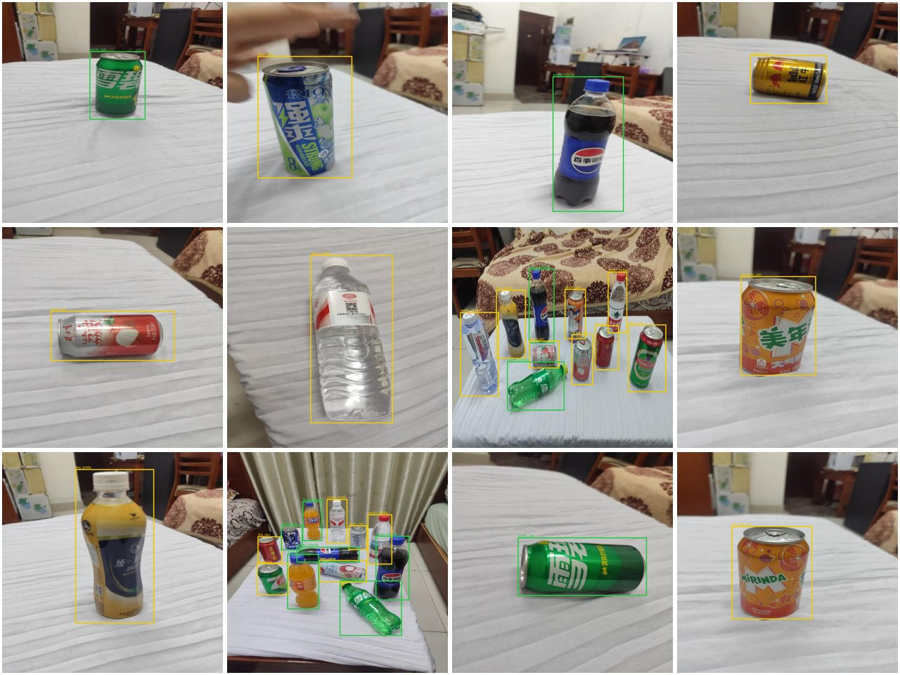
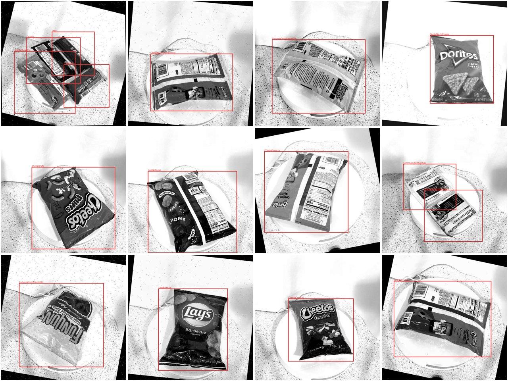
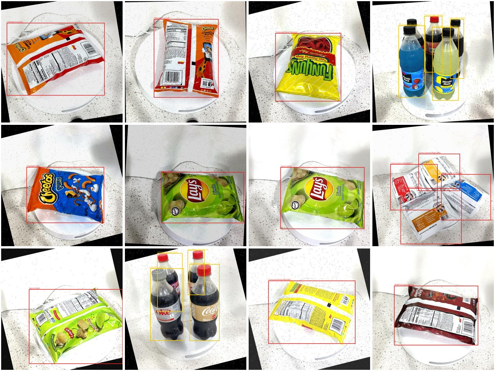
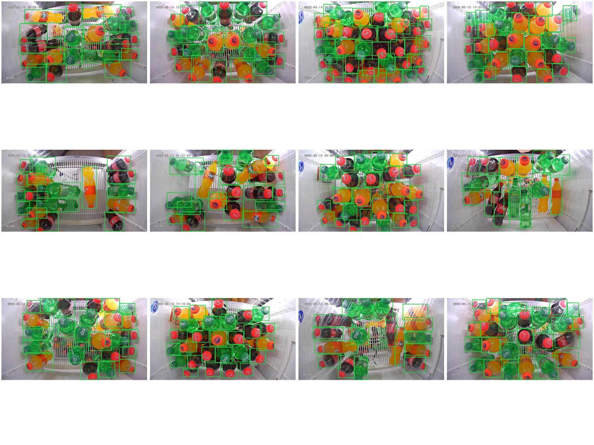
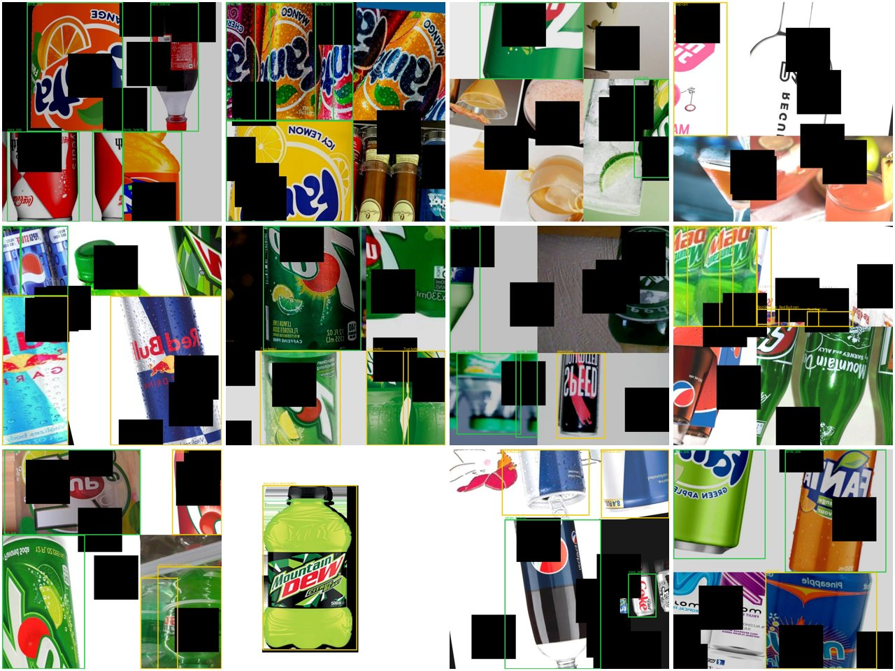
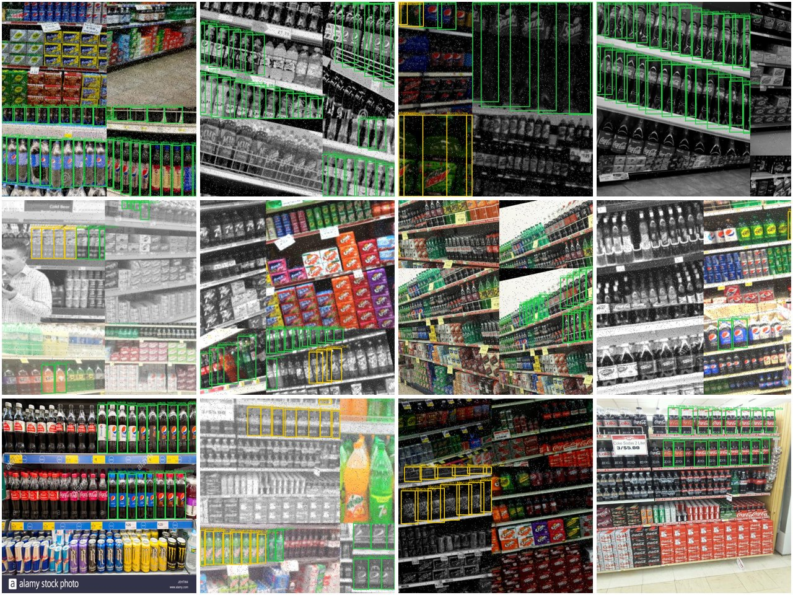
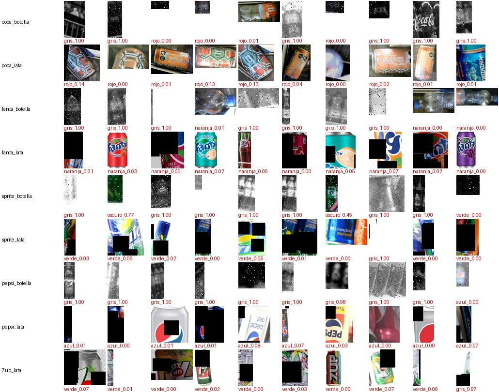
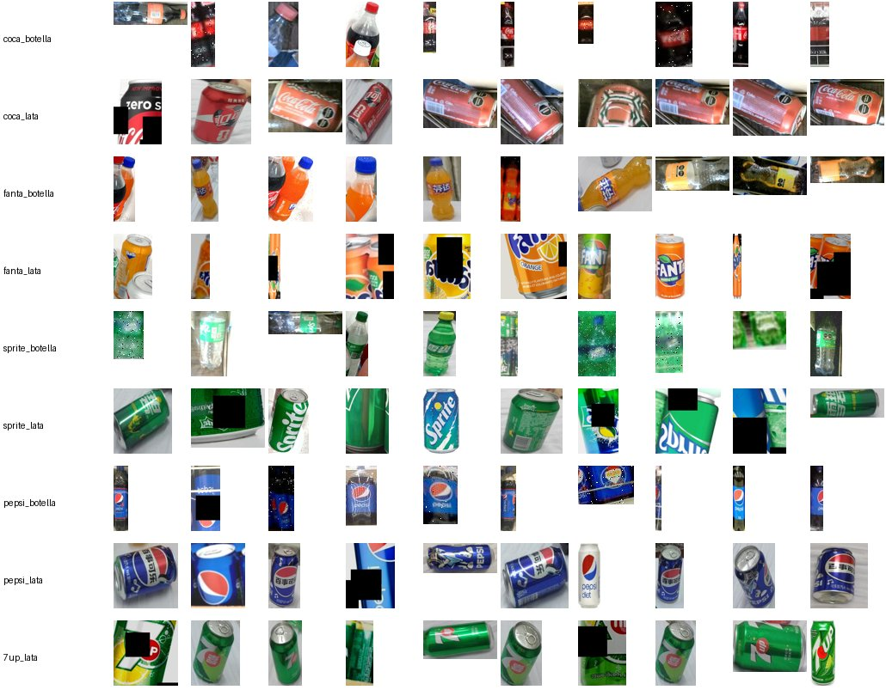
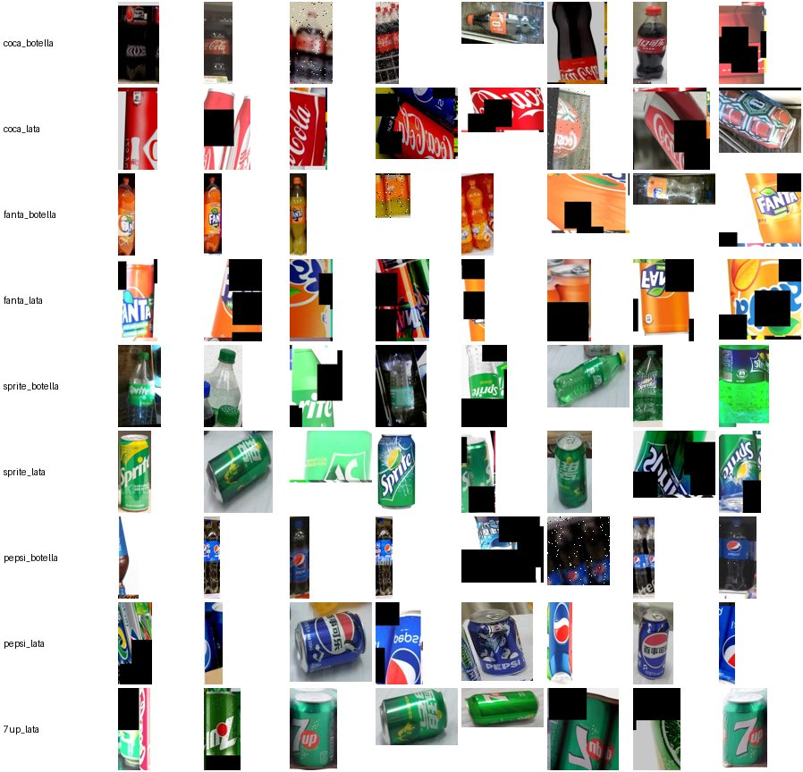

# Datos públicos: reporte de calidad y conteos

Generado por `scripts/datos_reporte.py` el 2026-10-16. Los datos viven en `DIR_DATOS` (`datos/raw`, `datos/fusion`, `datos/recortes`; no se versionan).

Pipeline (cada paso es un script idempotente; el notebook `notebooks/02_datos.ipynb` los llama):

1. `datos_descargar.py` → `raw/<alias>/` (última versión, formato YOLOv8; licencia en `_fuente.json`)
2. `datos_remapeo.py` → borrador `config/remapeo_clases.yaml`
3. `datos_indexar.py` → `fusion/_indice_imagenes.csv` (pHash, grupos anti-fuga, split)
4. `datos_color.py` → `fusion/_control_color.csv` (control de color por clase)
5. `datos_fusionar.py` → `fusion/detector_1clase/` y `fusion/multiclase/`
6. `datos_recortes.py` → `recortes/<split>/<clase>/` + `indice_recortes.csv`
7. `datos_reporte.py` → este documento

## Criterios

- **Grupo anti-fuga** = misma foto original: mismo proyecto de Roboflow y mismo nombre sin el sufijo `.rf.<hash>` (copias aumentadas y la misma foto en otra versión), unido con toda imagen de pHash idéntico (duplicados, incluso entre datasets). El split se sortea por grupo (80/10/10, hash determinista); un dataset con uso `test_externo` va entero a test.
- Se usa 1 imagen por foto original (las copias aumentadas offline de Roboflow se descartan: YOLO y Keras aumentan en línea; `--copias-train N` permite usar más en train) y se quitan los duplicados exactos de pHash dentro de cada split. Las fotos distintas de un mismo grupo (ráfagas) se conservan.
- Datasets usados en cada salida: `usar_en` de `src/datos/fuentes.py`. De lamar_grocery_color solo se usa la carpeta train/ (las etiquetas de valid/test están desplazadas).
- **detector_1clase**: toda caja no descartada → `producto`; imágenes sin cajas útiles como negativos (≤ 10 % por split).
- **multiclase**: solo datasets de marcas y cajas de las 9 clases; las otras bebidas quedan como fondo. Se excluyen las imágenes con cajas genéricas sin marca (`Cans`, `Bottle-Detection`...), que podrían esconder una de nuestras marcas sin etiquetar.
- **recortes**: margen 5 %, se descartan cajas con lado < 32 px, borrosas (varianza del Laplaciano < 40 sobre el recorte a 128 px de alto) y duplicadas por pHash (si el duplicado está en otro split, se descarta el de val/test).

## Datasets

| alias | proyecto | versión | licencia | imágenes | estado |
|---|---|---|---|---|---|
| bottle_can_cup | ai-k6ynk/bottle-can-cup-dataset-pvesi | - | - | 0 | no disponible (el proyecto no tiene versiones publicadas) |
| tusafe_bottle_can | tusafes-workspace/bottle-can-data-set | - | - | 0 | no disponible (el proyecto no tiene versiones publicadas) |
| darians_bottle | darians-workspace-4fake/bottle-detection-q9eas | 2 | CC BY 4.0 | 56670 | descargado |
| rosd_final_hr | rosd/final_hr | 1 | CC BY 4.0 | 3466 | descargado |
| coca_raspberry | new-workspace-ihwlk/coca-cola-raspberry | - | - | 0 | no disponible (el proyecto no tiene versiones publicadas) |
| lamar_grocery | lamar-university-venef/grocery-rfn8l | 9 | CC BY 4.0 | 35380 | descargado |
| lamar_grocery_color | lamar-university-venef/grocery-rfn8l | 1 | CC BY 4.0 | 8099 | descargado |
| soda_bottles | roboflow-100/soda-bottles | 4 | CC BY 4.0 | 2249 | descargado |
| cold_drinks | cold-drinks-cftkw/cold-drinks-qki32 | 1 | CC BY 4.0 | 3708 | descargado |
| again_aug | again/aug-tygyc | 5 | CC BY 4.0 | 2504 | descargado |
| sku110k_sub | ultralytics/SKU-110K | - | - | 0 | no disponible (sin descargar) |

Atribución (CC BY 4.0): cada dataset pertenece a su autor en Roboflow Universe (https://universe.roboflow.com/<workspace>/<proyecto>).

### `bottle_can_cup` — ai-k6ynk/bottle-can-cup-dataset-pvesi

**No disponible**: el proyecto no tiene versiones publicadas.

Nota: Licencia declarada CC BY 4.0. Sin versiones publicadas en Universe (15 000 imágenes, clases Bottle/Can/Cup): la API no permite exportarlo. Habría que hacer un fork al workspace propio y generar una versión.

### `tusafe_bottle_can` — tusafes-workspace/bottle-can-data-set

**No disponible**: el proyecto no tiene versiones publicadas.

Nota: Licencia declarada CC BY 4.0. Sin versiones publicadas en Universe (13 800 imágenes, clases Bottle/Can): no exportable. Misma solución que bottle_can_cup (fork + versión).

### `darians_bottle` — darians-workspace-4fake/bottle-detection-q9eas

- **Licencia**: CC BY 4.0 · **versión** v2 (de 2) · uso: `entrenamiento` · tipo: `marcas`
- Preprocesado de Roboflow: auto-orient, resize; aumentos offline: blur, brightness, crop, exposure, flip, hue, image, ninety, noise, rotate, saturation, shear
- Imágenes: **56670** · fotos originales: **23612** · copias aumentadas: 33058 (56670 con sufijo `.rf.<hash>`) · grupos anti-fuga (fotos + duplicados/ráfagas): 11840
- Duplicados por pHash con otra foto: 15595 · con otros datasets: 0 · imágenes sin cajas: 3734
- Tamaño típico: 416×416 px · cajas: 53150 (0.9 por imagen)

| id | clase original | cajas | destino |
|---|---|---|---|
| 1 | Bottle-Detection | 8151 | solo_detector |
| 2 | Cans | 4248 | solo_detector |
| 13 | NonBottle | 3638 | descartar |
| 4 | Coca_Original_Bottle | 2921 | coca_botella |
| 10 | Gatorade_Bottle | 2899 | solo_detector |
| 11 | Lipton_Bottle | 2873 | solo_detector |
| 14 | Penafiel_Limon_Bottel | 2848 | solo_detector |
| 16 | Sprite_Bottle | 2818 | sprite_botella |
| 6 | Electrolit_Bottle | 2814 | solo_detector |
| 8 | Fanta_Bottle | 2799 | fanta_botella |
| 0 | Bonafont_botella | 2798 | solo_detector |
| 3 | Coca_Light_Can | 2430 | solo_detector |
| 7 | Fanta_Berry_Can | 2406 | solo_detector |
| 9 | Fresca_Bottle | 2396 | solo_detector |
| 15 | Penafiel_Naranjada_Bottle | 2383 | solo_detector |
| 12 | Monster_Peach_Can | 2369 | solo_detector |
| 5 | Coca_Original_Can | 2359 | coca_lata |

Clases que no aportan marca: 42253 cajas (79 %).

**Veredicto**: BUENO. Productos mexicanos, casi siempre un envase acostado sobre una mesa, cajas ajustadas al envase entero. Letterbox 416 px y 3 copias aumentadas por foto en train (rotaciones de 90°, flips, recortes): se usa 1 copia por foto. Variantes (Coca Light, Fanta Berry) y otras marcas -> solo_detector. 'Cans' son latas Arizona y 'Bottle-Detection' botellas de agua.

### `rosd_final_hr` — rosd/final_hr

- **Licencia**: CC BY 4.0 · **versión** v1 (de 1) · uso: `entrenamiento` · tipo: `marcas`
- Preprocesado de Roboflow: auto-orient, resize; aumentos offline: ninguno
- Imágenes: **3466** · fotos originales: **3466** · copias aumentadas: 0 (3466 con sufijo `.rf.<hash>`) · grupos anti-fuga (fotos + duplicados/ráfagas): 3225
- Duplicados por pHash con otra foto: 391 · con otros datasets: 0 · imágenes sin cajas: 0
- Tamaño típico: 640×640 px · cajas: 9086 (2.6 por imagen)

| id | clase original | cajas | destino |
|---|---|---|---|
| 1 | beer_can | 2169 | solo_detector |
| 5 | juice_can | 1102 | solo_detector |
| 15 | water_bottle | 868 | solo_detector |
| 7 | mirinda_can | 480 | solo_detector |
| 4 | fanta_bottle | 431 | fanta_botella |
| 10 | redbull_can | 430 | solo_detector |
| 0 | 7up_can | 429 | 7up_lata |
| 14 | tea_can | 423 | solo_detector |
| 13 | tea_bottle | 409 | solo_detector |
| 3 | coke_can | 404 | coca_lata |
| 8 | pepsi_bottle | 400 | pepsi_botella |
| 9 | pepsi_can | 355 | pepsi_lata |
| 11 | sprite_bottle | 346 | sprite_botella |
| 2 | coke_bottle | 344 | coca_botella |
| 6 | milk_can | 259 | solo_detector |
| 12 | sprite_can | 237 | sprite_lata |

Clases que no aportan marca: 6140 cajas (68 %).

**Veredicto**: BUENO y CLAVE: única fuente de pepsi_botella, pepsi_lata y 7up_lata. Envases chinos (logos en chino para Coca y Sprite), fotos de mano/mesa, cajas completas, sin aumentos. Mirinda (lata naranja, parecida a Fanta) queda como solo_detector.

### `coca_raspberry` — new-workspace-ihwlk/coca-cola-raspberry

**No disponible**: el proyecto no tiene versiones publicadas.

Nota: Licencia declarada CC BY 4.0. No disponible: el proyecto está vacío (0 imágenes, sin versiones).

### `lamar_grocery` — lamar-university-venef/grocery-rfn8l

- **Licencia**: CC BY 4.0 · **versión** v9 (de 3) · uso: `entrenamiento` · tipo: `generico`
- Preprocesado de Roboflow: auto-orient, contrast, resize, grayscale; aumentos offline: blur, brightness, exposure, hue, image, noise, rotate, saturation
- Imágenes: **35380** · fotos originales: **1065** · copias aumentadas: 34315 (35380 con sufijo `.rf.<hash>`) · grupos anti-fuga (fotos + duplicados/ráfagas): 980
- Duplicados por pHash con otra foto: 692 · con otros datasets: 3065 · imágenes sin cajas: 0
- Tamaño típico: 640×640 px · cajas: 110980 (3.1 por imagen)

| id | clase original | cajas | destino |
|---|---|---|---|
| 12 | CocaCola20Oz | 4732 | coca_botella |
| 18 | DietCocaCola20Oz | 4245 | solo_detector |
| 53 | Sprite20Oz | 4178 | sprite_botella |
| 59 | VanillaCocaCola20Oz | 3569 | solo_detector |
| 51 | SkittlesShareSize | 3487 | descartar |
| 27 | FantaCan16Oz | 3476 | fanta_lata |
| 34 | LennyLarrysBirthdayCake | 2713 | descartar |
| 39 | LennyLarrysSnickerdoodle | 2713 | descartar |
| 38 | LennyLarrysPeanutButterChocolateChips | 2656 | descartar |
| 35 | LennyLarrysChocolateChips | 2656 | descartar |
| 40 | MinuteMaidBlueRaspberry20Oz | 2623 | solo_detector |
| 54 | Sprite40Oz | 2589 | sprite_botella |
| 37 | LennyLarrysPeanutButter | 2568 | descartar |
| 26 | Fanta20Oz | 2535 | fanta_botella |
| 29 | FantaZero20Oz | 2464 | solo_detector |
| 11 | CocaCola16Oz | 2393 | coca_lata |
| 36 | LennyLarrysDoubleChocolateChips | 2392 | descartar |
| 42 | MinuteMaidLemonade20Oz | 2196 | solo_detector |
| 15 | CocaColaZero16Oz | 2193 | solo_detector |
| 44 | MountainDew16Oz | 2193 | solo_detector |
| 14 | CocaColaSpiced20Oz | 2030 | solo_detector |
| 58 | SpriteZero20Oz | 2006 | solo_detector |
| 16 | Crunch | 1956 | descartar |
| 0 | BargsBlack20Oz | 1954 | solo_detector |
| 41 | MinuteMaidFruitPunch | 1925 | solo_detector |
| 47 | Oreo | 1874 | descartar |
| 43 | MinuteMaidPinkLemonade | 1872 | solo_detector |
| 57 | SpriteTropicalMix20Oz | 1868 | solo_detector |
| 10 | ChipsAhoyKingSize | 1854 | descartar |
| 49 | OreoKingSize | 1854 | descartar |
| 48 | OreoDoubleStufKingSize | 1854 | descartar |
| 24 | DrPapPepper20Oz | 1826 | solo_detector |
| 9 | ChipsAhoy | 1792 | descartar |
| 56 | SpriteCherry20Oz | 1617 | solo_detector |
| 1 | BuenoShareSize | 1613 | descartar |
| 60 | WhatchamacallitKingSize | 1613 | descartar |
| 46 | NerdsShareSize | 1613 | descartar |
| 52 | SourPunchShareSize | 1613 | descartar |
| 28 | FantaGrape20Oz | 1472 | solo_detector |
| 8 | CherryVanillaCocaCola20Oz | 1395 | solo_detector |
| 19 | DietCokeCan16Oz | 1388 | solo_detector |
| 7 | CherryCocaCola20Oz | 1384 | solo_detector |
| 50 | PaydayShareSize | 1349 | descartar |
| 25 | DrPapPepperCan16Oz | 1342 | solo_detector |
| 55 | SpriteCan16Oz | 1311 | sprite_lata |
| 31 | LaysBarbecue | 963 | descartar |
| 33 | LaysLimon | 955 | descartar |
| 4 | CheetosCrunchyFlaminHotLimon | 954 | descartar |
| 6 | CheetosPuffs | 948 | descartar |
| 21 | DoritosNachoCheese | 935 | descartar |
| 20 | DoritosCoolRanch | 915 | descartar |
| 2 | CheetosCrunchy | 662 | descartar |
| 22 | DoritosSpicyNacho | 654 | descartar |
| 5 | CheetosCrunchyXXTRAFlaminHot | 646 | descartar |
| 30 | FunyunsOnionFlavoredRingsFlaminHot | 586 | descartar |
| 32 | LaysClassic | 523 | descartar |
| 3 | CheetosCrunchyFlaminHot | 409 | descartar |
| 17 | Crush16Oz | 220 | solo_detector |
| 45 | MtnDew16Oz | 208 | solo_detector |
| 61 | ZeroCocaCola16Oz | 200 | solo_detector |
| 23 | DrPapPepper1L | 164 | solo_detector |
| 13 | CocaCola350Ml | 92 | solo_detector |

Clases que no aportan marca: 89766 cajas (81 %).

**Veredicto**: NO SE USA. La última versión (v9) viene en ESCALA DE GRISES (preprocesado grayscale + contraste), así que no sirve para marcas, y comparte fotos con la v1 (lamar_grocery_color). Igual que en la v1, las etiquetas de valid/test están DESPLAZADAS respecto de los productos. Más de la mitad de las clases son snacks (descartar).

### `lamar_grocery_color` — lamar-university-venef/grocery-rfn8l

- **Licencia**: CC BY 4.0 · **versión** v1 (de 3) · uso: `entrenamiento` · tipo: `marcas`
- Preprocesado de Roboflow: auto-orient, resize; aumentos offline: blur, brightness, exposure, image, noise, rotate
- Imágenes: **8099** · fotos originales: **1374** · copias aumentadas: 6725 (8099 con sufijo `.rf.<hash>`) · grupos anti-fuga (fotos + duplicados/ráfagas): 1351
- Duplicados por pHash con otra foto: 127 · con otros datasets: 1597 · imágenes sin cajas: 28
- Tamaño típico: 640×640 px · cajas: 15106 (1.9 por imagen)

| id | clase original | cajas | destino |
|---|---|---|---|
| 18 | DietCoca-cola 20Oz | 483 | solo_detector |
| 15 | DORITOS-Cool-Ranch | 483 | descartar |
| 28 | Lay-s-Limon | 483 | descartar |
| 4 | Cheetos-Puffs | 476 | descartar |
| 6 | Cheetos-crunchy-XXTRA-Flamin-Hot | 469 | descartar |
| 25 | Funyuns-Onion-flavored-rings-Flamin-hot | 469 | descartar |
| 17 | DORITOS-Spicy-Nacho | 469 | descartar |
| 16 | DORITOS-Nacho-Cheese | 469 | descartar |
| 2 | Cheetos-Crunchy | 469 | descartar |
| 5 | Cheetos-crunchy-Flamin-Hot-Limon | 469 | descartar |
| 26 | Lay-s-Barbecue | 469 | descartar |
| 27 | Lay-s-Classic | 469 | descartar |
| 3 | Cheetos-Crunchy-Flamin-Hot | 462 | descartar |
| 11 | Coca-cola 20Oz | 441 | coca_botella |
| 54 | Vanilla-Coca-cola 20Oz | 420 | solo_detector |
| 52 | Sprite20Oz | 406 | sprite_botella |
| 39 | MtnDew-16Oz | 245 | solo_detector |
| 58 | zeroCocaCola-16Oz | 238 | solo_detector |
| 12 | CocaCola-16Oz | 238 | coca_lata |
| 53 | Sprite40Oz | 238 | sprite_botella |
| 8 | CherryVanilla-Coca-cola 20Oz | 231 | solo_detector |
| 14 | Crush-16Oz | 231 | solo_detector |
| 7 | Cherry-Coca-cola 20Oz | 231 | solo_detector |
| 29 | Lenny-Larry-s-BirthdayCake | 224 | descartar |
| 23 | Fanta20Oz | 224 | fanta_botella |
| 33 | Lenny-Larry-s-PeanutButter-ChocolateChips | 224 | descartar |
| 34 | Lenny-Larry-s-Snickerdoodle | 224 | descartar |
| 30 | Lenny-Larry-s-ChocolateChips | 224 | descartar |
| 32 | Lenny-Larry-s-PeanutButter | 217 | descartar |
| 37 | MinuteMaidBlueRaspberry-20Oz | 217 | solo_detector |
| 24 | FantaZero20Oz | 210 | solo_detector |
| 31 | Lenny-Larry-s-DoubleChocolateChips | 203 | descartar |
| 36 | MinuteMaid-PinkLemonade | 196 | solo_detector |
| 51 | Sprite-Zero-20Oz | 196 | solo_detector |
| 35 | MinuteMaid-FruitPunch | 189 | solo_detector |
| 38 | MinuteMaidLemonade-20Oz | 189 | solo_detector |
| 19 | Dr.Papper-1L | 182 | solo_detector |
| 50 | Sprite-TropicalMix-20Oz | 182 | solo_detector |
| 47 | Spiced-Coca-cola 20Oz | 175 | solo_detector |
| 0 | Barg-sBlack-20Oz | 175 | solo_detector |
| 49 | Sprite-Cherry-20Oz | 161 | solo_detector |
| 13 | Crunch | 161 | descartar |
| 10 | Chips-Ahoy-KingSize | 161 | descartar |
| 42 | Oreo-DoubleStuf-KingSize | 161 | descartar |
| 43 | Oreo-KingSize | 161 | descartar |
| 57 | skittles-smoothies-shareSize | 154 | descartar |
| 41 | Oreo | 154 | descartar |
| 9 | Chips-Ahoy | 147 | descartar |
| 22 | Fanta-Grape-20Oz | 147 | solo_detector |
| 1 | Bueno-shareSize | 126 | descartar |
| 40 | Nerds-shareSize | 126 | descartar |
| 55 | Whatchamacallit-kingSize | 126 | descartar |
| 45 | Skittles-shareSize | 126 | descartar |
| 46 | SourPunch-shareSize | 126 | descartar |
| 56 | dietCoke-Can16oz | 119 | solo_detector |
| 20 | Dr.Papper-Can16oz | 112 | solo_detector |
| 21 | Fanta-Can16oz | 112 | fanta_lata |
| 48 | Sprite-Can16oz | 112 | sprite_lata |
| 44 | PayDay-shareSize | 105 | descartar |

Clases que no aportan marca: 13335 cajas (88 %).

**Veredicto**: REGULAR. Versión en color (v1). Estudio: productos sobre un plato giratorio, fondo blanco, cajas completas en train. PERO las etiquetas de las carpetas valid/ y test/ de Roboflow están desplazadas (no coinciden con los productos): solo se usan las imágenes de train/ (7 copias aumentadas por foto). Las fotos se llaman '01', '02'... (el nombre no identifica la foto): se agrupan por pHash cercano. Única fuente de fanta_lata (pocas: ~120 fotos).

### `soda_bottles` — roboflow-100/soda-bottles

- **Licencia**: CC BY 4.0 · **versión** v4 (de 2) · uso: `entrenamiento` · tipo: `marcas`
- Preprocesado de Roboflow: remap; aumentos offline: ninguno
- Imágenes: **2249** · fotos originales: **2249** · copias aumentadas: 0 (2249 con sufijo `.rf.<hash>`) · grupos anti-fuga (fotos + duplicados/ráfagas): 2243
- Duplicados por pHash con otra foto: 12 · con otros datasets: 0 · imágenes sin cajas: 0
- Tamaño típico: 1920×1080 px · cajas: 54686 (24.3 por imagen)

| id | clase original | cajas | destino |
|---|---|---|---|
| 2 | sprite | 18747 | sprite_botella |
| 0 | coca-cola | 18513 | coca_botella |
| 1 | fanta | 17426 | fanta_botella |

**Veredicto**: REGULAR para nuestro caso. Cámara cenital en heladeras: las cajas son TAPAS de botellas vistas desde arriba (~25 por imagen). Útil para el detector (escenas densas); no para el multiclase ni el clasificador, porque una tapa no representa la vista frontal de la góndola y sus ~54 000 cajas aplastarían a las demás fuentes.

### `cold_drinks` — cold-drinks-cftkw/cold-drinks-qki32

- **Licencia**: CC BY 4.0 · **versión** v1 (de 1) · uso: `entrenamiento` · tipo: `marcas`
- Preprocesado de Roboflow: resize, filter-null; aumentos offline: blur, brightness, crop, cutout, flip, image, mosaic, rotate
- Imágenes: **3708** · fotos originales: **3700** · copias aumentadas: 8 (3708 con sufijo `.rf.<hash>`) · grupos anti-fuga (fotos + duplicados/ráfagas): 3640
- Duplicados por pHash con otra foto: 116 · con otros datasets: 1 · imágenes sin cajas: 2
- Tamaño típico: 640×640 px · cajas: 13538 (3.7 por imagen)

| id | clase original | cajas | destino |
|---|---|---|---|
| 3 | Red Bull can | 1446 | solo_detector |
| 10 | fanta bottel | 1054 | fanta_botella |
| 23 | sprite bottel | 1042 | sprite_botella |
| 19 | pepsi bottel | 993 | pepsi_botella |
| 16 | mountain dew bottel | 976 | solo_detector |
| 6 | coca cola bottel | 960 | coca_botella |
| 0 | 7up bottel | 850 | solo_detector |
| 1 | 7up can | 837 | 7up_lata |
| 7 | coca cola can | 803 | coca_lata |
| 11 | fanta can | 738 | fanta_lata |
| 12 | mirinda bottel | 701 | solo_detector |
| 20 | pepsi can | 697 | pepsi_lata |
| 24 | sprite can | 675 | sprite_lata |
| 13 | mirinda can | 542 | solo_detector |
| 18 | mountain dew can | 515 | solo_detector |
| 9 | coke can | 164 | coca_lata |
| 22 | speed can | 128 | solo_detector |
| 15 | mojo can | 107 | solo_detector |
| 2 | Red Bull bottel | 99 | solo_detector |
| 21 | speed bottel | 73 | solo_detector |
| 8 | coke bottel | 53 | coca_botella |
| 4 | clemon bottel | 32 | solo_detector |
| 14 | mojo bottel | 31 | solo_detector |
| 25 | tango bottel | 10 | solo_detector |
| 26 | tango can | 7 | solo_detector |
| 5 | clemon can | 4 | solo_detector |
| 17 | mountain dew bottle | 1 | solo_detector |

Clases que no aportan marca: 5522 cajas (41 %).

**Veredicto**: BUENO para marcas. Imágenes de catálogo/web (envase sobre fondo blanco, pocas fotos reales), cajas completas, botellas y latas separadas. Trae variantes rotuladas como la marca (Fanta frutilla/uva, Sprite Zero, 7up Free, Pepsi Diet): el control de color filtra las más obvias. Brecha de dominio con la góndola real.

### `again_aug` — again/aug-tygyc

- **Licencia**: CC BY 4.0 · **versión** v5 (de 5) · uso: `entrenamiento` · tipo: `marcas`
- Preprocesado de Roboflow: auto-orient, resize, remap; aumentos offline: blur, brightness, crop, exposure, image, mosaic, noise, rotate, saturation
- Imágenes: **2504** · fotos originales: **613** · copias aumentadas: 1891 (2504 con sufijo `.rf.<hash>`) · grupos anti-fuga (fotos + duplicados/ráfagas): 602
- Duplicados por pHash con otra foto: 26 · con otros datasets: 1 · imágenes sin cajas: 65
- Tamaño típico: 640×640 px · cajas: 51104 (20.4 por imagen)

| id | clase original | cajas | destino |
|---|---|---|---|
| 7 | Pepsi | 15567 | pepsi_botella |
| 0 | Coca Cola | 12306 | coca_botella |
| 9 | Sprite | 9092 | sprite_botella |
| 3 | Fanta | 8020 | fanta_botella |
| 5 | Mountain Dew | 5732 | solo_detector |
| 2 | Coco Cola | 229 | solo_detector |
| 8 | Pepsi  | 67 | pepsi_botella |
| 1 | Coca Cola  | 43 | coca_botella |
| 6 | Mountain Dew  | 28 | solo_detector |
| 10 | Sprite  | 14 | sprite_botella |
| 4 | Fanta  | 6 | fanta_botella |

Clases que no aportan marca: 5989 cajas (12 %).

**Veredicto**: REGULAR. Góndolas reales de supermercado (muy cerca de nuestro caso), pero con ETIQUETADO INCOMPLETO: muchas botellas y todas las latas visibles quedan sin caja, así que no sirve para los datasets YOLO (enseñaría que un producto es fondo). La v5 solo trae 11 clases sin formato (las 77 del proyecto con 'lon'/'chai' no están en ninguna versión); son botellas -> *_botella. Aumentos fuertes (mosaicos, grises, ruido): el control de color descarta los recortes en grises. Solo se usa para los recortes del clasificador.

### `sku110k_sub` — ultralytics/SKU-110K

**No disponible**: no descargado.

Nota: PENDIENTE (opcional, 13,6 GB). Góndolas densas, 1 clase. Licencia de investigación (no comercial).

## Conteos finales

### detector_1clase

| split | imagenes | cajas | negativos |
|---|---|---|---|
| train | 22756 | 74015 | 2068 |
| val | 2928 | 10036 | 266 |
| test | 2908 | 9596 | 263 |

| clase | img train | cajas train | img val | cajas val | img test | cajas test |
|---|---|---|---|---|---|---|
| producto | 20688 | 74015 | 2662 | 10036 | 2645 | 9596 |

Por dataset de origen (imágenes):

| alias | train | val | test |
|---|---|---|---|
| cold_drinks | 2907 | 365 | 368 |
| darians_bottle | 14560 | 1850 | 1825 |
| lamar_grocery_color | 961 | 131 | 157 |
| rosd_final_hr | 2552 | 344 | 329 |
| soda_bottles | 1776 | 238 | 229 |

Verificación de fugas: **sin fugas** (ningún grupo ni pHash en dos splits).

### multiclase

| split | imagenes | cajas | negativos |
|---|---|---|---|
| train | 4647 | 6433 | 422 |
| val | 610 | 813 | 55 |
| test | 584 | 823 | 53 |

| clase | img train | cajas train | img val | cajas val | img test | cajas test |
|---|---|---|---|---|---|---|
| coca_botella | 860 | 979 | 127 | 137 | 121 | 146 |
| coca_lata | 977 | 1099 | 114 | 127 | 125 | 133 |
| fanta_botella | 856 | 981 | 118 | 142 | 88 | 110 |
| fanta_lata | 154 | 214 | 21 | 22 | 16 | 18 |
| sprite_botella | 1023 | 1111 | 128 | 134 | 132 | 143 |
| sprite_lata | 321 | 369 | 39 | 47 | 44 | 46 |
| pepsi_botella | 455 | 635 | 58 | 67 | 50 | 64 |
| pepsi_lata | 394 | 474 | 44 | 55 | 58 | 79 |
| 7up_lata | 429 | 571 | 69 | 82 | 63 | 84 |

Por dataset de origen (imágenes):

| alias | train | val | test |
|---|---|---|---|
| cold_drinks | 1113 | 133 | 135 |
| darians_bottle | 2282 | 301 | 285 |
| lamar_grocery_color | 263 | 36 | 35 |
| rosd_final_hr | 989 | 140 | 129 |

Verificación de fugas: **sin fugas** (ningún grupo ni pHash en dos splits).

### Control de color (etiquetas equivocadas)

`scripts/datos_color.py` mide, en la zona central de cada caja con marca, la fracción de píxeles rojos/naranjas/verdes/azules, oscuros (líquido de cola) y grises, y aplica un mínimo por clase (`src/datos/color.py`): coca_lata rojo ≥ 0,15; coca_botella rojo ≥ 0,05 y oscuro ≥ 0,10 (botella vacía); fanta naranja ≥ 0,10; sprite/7up verde ≥ 0,08 (sprite_botella oscuro ≤ 0,35); pepsi azul ≥ 0,08; y descarta las cajas en escala de grises (gris > 0,97). La caja rechazada no entra a los recortes y su imagen sale del multiclase (queda en el detector). Nada se borra de `raw/`; el detalle está en `fusion/_control_color.csv`, `fusion/multiclase/_descartes_color.csv` y en la columna `motivo_descarte` de `recortes/indice_recortes.csv`.

Cajas rechazadas: 38536 de 68744. Porcentaje por clase y fuente:

| clase | again_aug | cold_drinks | darians_bottle | lamar_grocery_color | rosd_final_hr |
|---|---|---|---|---|---|
| coca_botella | 70 % | 30 % | 65 % | 18 % | 0 % |
| coca_lata | - | 20 % | 33 % | 0 % | 1 % |
| fanta_botella | 70 % | 29 % | 49 % | 5 % | 0 % |
| fanta_lata | - | 42 % | - | 0 % | - |
| sprite_botella | 69 % | 41 % | 32 % | 14 % | 0 % |
| sprite_lata | - | 24 % | - | 0 % | 0 % |
| pepsi_botella | 67 % | 35 % | - | - | 2 % |
| pepsi_lata | - | 19 % | - | - | 0 % |
| 7up_lata | - | 36 % | - | - | 0 % |

Qué saca (ver grillas): variantes de otro color rotuladas con la marca (Fanta frutilla/uva/manzana, Pepsi Diet, 7up Free), latas naranjas rotuladas coca_lata y botellas vacías de darians_bottle, las copias en grises de again_aug y los recortes tapados por los cuadros negros (cutout) de cold_drinks. Las latas de Coca-Cola con diseño geométrico rojo/turquesa de darians son una edición real de Coca-Cola: con rojo ≥ 0,15 se conserva la mayoría.

Rechazadas (muestra):

Aceptadas (muestra):

### recortes (clasificador)

Recortes guardados (clase × split):

| clase | train | val | test | total |
|---|---|---|---|---|
| coca_botella | 1634 | 189 | 211 | 2034 |
| coca_lata | 1310 | 151 | 146 | 1607 |
| fanta_botella | 1609 | 213 | 183 | 2005 |
| fanta_lata | 380 | 33 | 32 | 445 |
| sprite_botella | 1757 | 190 | 184 | 2131 |
| sprite_lata | 589 | 74 | 71 | 734 |
| pepsi_botella | 1496 | 168 | 180 | 1844 |
| pepsi_lata | 672 | 70 | 94 | 836 |
| 7up_lata | 660 | 91 | 95 | 846 |

Por dataset de origen:

| clase | again_aug | cold_drinks | darians_bottle | lamar_grocery_color | rosd_final_hr |
|---|---|---|---|---|---|
| coca_botella | 593 | 697 | 355 | 106 | 283 |
| coca_lata | 0 | 760 | 447 | 78 | 322 |
| fanta_botella | 421 | 738 | 468 | 62 | 316 |
| fanta_lata | 0 | 407 | 0 | 38 | 0 |
| sprite_botella | 534 | 602 | 581 | 160 | 254 |
| sprite_lata | 0 | 504 | 0 | 38 | 192 |
| pepsi_botella | 878 | 640 | 0 | 0 | 326 |
| pepsi_lata | 0 | 553 | 0 | 0 | 283 |
| 7up_lata | 0 | 528 | 0 | 0 | 318 |

Descartes por motivo:

| clase | borrosa | chica | color_azul | color_gris | color_naranja | color_oscuro | color_rojo | color_verde | duplicada | duplicada_entre_splits | duplicada_otra_clase |
|---|---|---|---|---|---|---|---|---|---|---|---|
| coca_botella | 22 | 1211 | 0 | 594 | 0 | 534 | 608 | 0 | 6 | 3 | 0 |
| coca_lata | 3 | 2 | 0 | 31 | 0 | 0 | 439 | 0 | 2 | 3 | 0 |
| fanta_botella | 12 | 804 | 0 | 582 | 931 | 0 | 0 | 0 | 4 | 4 | 0 |
| fanta_lata | 3 | 4 | 0 | 7 | 302 | 0 | 0 | 0 | 2 | 0 | 0 |
| sprite_botella | 8 | 750 | 0 | 446 | 0 | 501 | 0 | 423 | 5 | 1 | 0 |
| sprite_lata | 0 | 1 | 0 | 5 | 0 | 0 | 0 | 159 | 0 | 0 | 0 |
| pepsi_botella | 8 | 1531 | 736 | 808 | 0 | 0 | 0 | 0 | 2 | 2 | 1 |
| pepsi_lata | 3 | 10 | 117 | 14 | 0 | 0 | 0 | 0 | 5 | 4 | 0 |
| 7up_lata | 5 | 16 | 0 | 24 | 0 | 0 | 0 | 254 | 5 | 3 | 1 |

Nitidez (varianza del Laplaciano a 128 px de alto): percentiles 5/25/50 = 217 / 585 / 1246.

Verificación de fugas: **sin fugas**.

## Avisos

- multiclase: `fanta_lata` tiene 214 cajas en train (< 300)

## Conclusiones y propuestas

- **No hay test externo**: ningún dataset de marcas se puede reservar entero sin dejar clases en cero
  (rosd_final_hr es la única fuente de pepsi y 7up; darians_bottle aporta ~80 % de coca_lata).
  El test se arma con grupos (fotos originales) de todos los datasets. La prueba de dominio real
  será la maqueta.
- **Grupos anti-fuga**: además del id original de Roboflow, se unen las imágenes con pHash idéntico.
  En darians_bottle eso junta ráfagas de hasta ~240 fotos de la misma escena (mismo split).
  lamar_grocery nombra sus fotos '01', '02'... (el nombre no identifica la foto): esos ids se
  subdividen por pHash cercano (Hamming ≤ 10).
- **lamar_grocery**: las etiquetas de sus carpetas valid/ y test/ están desplazadas respecto de los
  productos (verificado a ojo en v1 y v9); solo se usa train/ de la v1 (color).
- **Segunda ronda** (aprobada): se sumaron cold_drinks (todas las salidas) y again_aug (solo recortes:
  góndolas reales pero con etiquetado incompleto) y un **control de color por clase** que descarta
  cajas con etiqueta equivocada (ver la sección de control de color). Los splits de la primera ronda
  se mantuvieron: 0 imágenes cambiaron de split; solo se sortearon las nuevas.
- Con eso todas las clases superan 300 recortes en train. En el multiclase **fanta_lata sigue corta**
  (cajas en train < 300; las fuentes de latas de Fanta son lamar y cold_drinks). Propuesta: sintéticos
  de fanta_lata (notebook 03) y fotos propias de la maqueta; como paliativo, ponderar la clase.

## Pendientes

- SKU-110K (13,6 GB): opcional, no descargado. `scripts/datos_sku110k.py --max-imagenes 1500 --confirmar`
  extrae un subconjunto en streaming (igual baja los 13,6 GB) y lo suma al detector_1clase.
- bottle_can_cup y tusafe_bottle_can: requieren fork al workspace propio + generar versión en Roboflow.
- Remapeo aprobado en la 1.ª ronda; las entradas de cold_drinks y again_aug están pendientes de aprobación.
